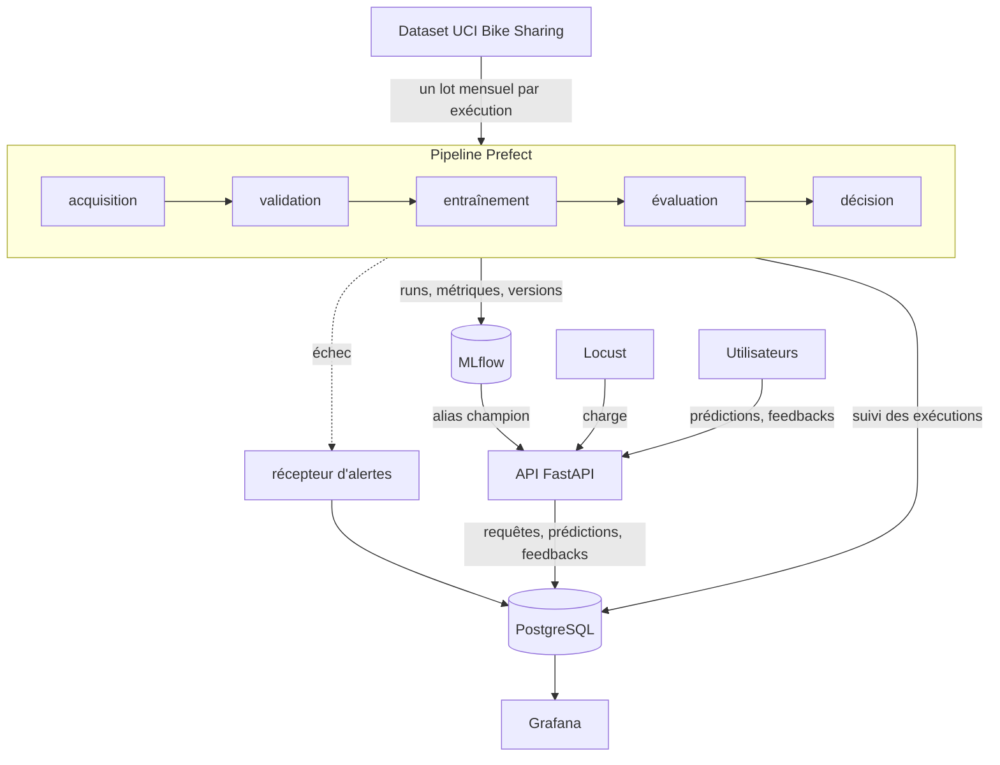

# bikeshare-mlops

Prévision du nombre de locations de vélos en libre-service, heure par heure, avec toute la chaîne MLOps autour : ingestion des données, contrôles qualité, entraînement orchestré, registre de modèles, API de prédiction, feedbacks, tests de charge et supervision.

Projet final du module 5MLDE (SUPINFO). Le modèle est volontairement simple (gradient boosting scikit-learn) : le sujet du projet est la chaîne, pas le score.

## Architecture



| Service | Rôle | Adresse locale |
|---|---|---|
| `api` | prédictions, feedbacks, Swagger | http://localhost:8001/docs |
| `prefect` | orchestration et suivi des exécutions | http://localhost:4200 |
| `mlflow` | suivi des entraînements et registre de modèles | http://localhost:7281 |
| `grafana` | dashboards (admin / `bikeshare-local-admin`) | http://localhost:3000 |
| `pipeline` | exécute le flow d'entraînement planifié | |
| `alert-sink` | reçoit les alertes de Prefect | http://localhost:8002 |
| `postgres` | traces de l'API, suivi du pipeline, base de Prefect | localhost:5432 |

Détail des choix dans [docs/architecture.md](docs/architecture.md).

## Démarrage rapide

Prérequis : Docker (avec Compose) et `make`. Rien d'autre à installer.

```sh
git clone https://github.com/Hugobrbs/bikeshare-mlops.git
cd bikeshare-mlops
make up
```

`make up` crée `.env` à partir de `.env.example`, construit les images en y inscrivant le commit courant et démarre tout. Au premier lancement le pipeline :

1. télécharge le dataset depuis l'UCI et vérifie son empreinte ;
2. ingère les six premiers mois (2011-01 à 2011-06) après contrôle qualité ;
3. entraîne un premier modèle, l'enregistre dans MLflow et le promeut `champion`.

Une fois les images construites, l'API est prête environ une minute et demie après `make up` (`curl localhost:8001/health/ready`). Ensuite le déploiement Prefect rejoue un nouveau mois toutes les 10 minutes (`PIPELINE_SCHEDULE_SECONDS`), ou tout de suite avec `make train`.

```sh
make ps        # état des services
make logs      # logs du pipeline et de l'API
make down      # arrêt, les volumes sont conservés
make reset     # arrêt et suppression des volumes, pour repartir de zéro
```

## Données

Dataset [UCI Bike Sharing](https://archive.ics.uci.edu/dataset/275/bike+sharing+dataset) (Capital Bikeshare, Washington D.C., 2011-2012), licence CC BY 4.0. Il n'est pas versionné : il est téléchargé au premier lancement et vérifié par sha256.

Le dataset est historique. Pour simuler l'arrivée de nouvelles données, il est rejoué mois par mois : à chaque exécution du pipeline, le mois suivant est déposé dans `data/incoming/` comme le ferait un export périodique. Provenance, licence et dictionnaire des colonnes : [data/README.md](data/README.md).

## Ce que fait le pipeline

| Etape | Ce qui se passe | Si ça échoue |
|---|---|---|
| acquisition | télécharge la source (une fois) et dépose le lot suivant | 3 nouvelles tentatives si l'erreur est transitoire, URL de secours |
| validation | 42 contrôles par lot : 40 expectations Great Expectations et 2 règles métier | lot mis en quarantaine, exécution arrêtée, alerte |
| préparation | fenêtre des 12 derniers mois, 7 derniers jours gardés pour le test | |
| entraînement | gradient boosting + baseline (moyenne par heure) | |
| évaluation | candidat, baseline et champion en place sur le même jeu de test | |
| publication | données, paramètres, métriques, graphiques et modèle dans MLflow | 2 nouvelles tentatives, sans créer de doublon |
| décision | politique de promotion (`config/promotion-policy.yaml`) | modèle rejeté : le champion reste en place |

Un lot invalide n'atteint jamais l'entraînement, et un modèle qui ne passe pas la politique n'est jamais servi.

## Utiliser l'API

La documentation interactive (Swagger) est sur http://localhost:8001/docs.

```sh
curl -s localhost:8001/predict -H 'content-type: application/json' -d '{
  "observation": {
    "timestamp": "2012-06-15T08:00:00",
    "holiday": false,
    "weather_code": 1,
    "temperature_c": 22.5,
    "feels_like_c": 25.0,
    "humidity_pct": 60,
    "windspeed_kmh": 12.0
  }
}'
```

```json
{
  "request_id": "3c1f...",
  "model": {"name": "bikeshare-demand", "version": 2, "run_id": "87be...", "alias": "champion"},
  "prediction": {"prediction_id": "9a41...", "item_index": 0, "predicted_rentals": 471.52}
}
```

| Endpoint | Rôle |
|---|---|
| `POST /predict` | une prédiction |
| `POST /predict/batch` | 1 à 100 prédictions, tout ou rien |
| `POST /feedback` | avis ou valeur réelle pour une prédiction (rejouable sans doublon) |
| `GET /model` | version servie |
| `POST /admin/model/refresh` | relit l'alias tout de suite (en-tête `X-Admin-Token`) |
| `GET /health/live`, `GET /health/ready` | sondes |

Chaque réponse donne la version exacte du modèle. Chaque requête, prédiction et feedback est enregistré dans PostgreSQL avec sa durée et son éventuel code d'erreur.

## Promotion et retour arrière

Le modèle servi est celui que désigne l'alias `champion` dans MLflow. L'API relit cet alias toutes les 30 secondes : promouvoir ou revenir en arrière ne demande aucun redéploiement.

```sh
make registry-status     # versions, statut de validation, alias
make rollback            # remet le champion précédent en service, refusé s'il n'y en a pas
```

La version quittée par un retour arrière est marquée `rolled_back` : elle ne peut plus être promue, et l'API refuse de charger une version qui n'est pas approuvée, même si l'alias est déplacé à la main dans MLflow.

## Démonstration

Le scénario complet (fonctionnement nominal, lot invalide, retour arrière, panne de MLflow, panne de PostgreSQL, pipeline tué en plein run, charge) est décrit pas à pas dans [docs/demo.md](docs/demo.md). Le plus court :

```sh
make incident-data       # dépose un lot tronqué et lance le pipeline
```

Le flow échoue à l'étape de validation, le lot part en quarantaine, une alerte arrive dans Grafana (dashboard "Bikeshare - Pipeline") et l'API continue de servir le champion. Au cycle suivant le lot est relivré propre et le pipeline repart tout seul.

## Développement

Prérequis : [uv](https://docs.astral.sh/uv/) (il installe Python 3.12 tout seul).

```sh
make install             # environnement verrouillé par uv.lock
make lint test           # ruff + tests unitaires
make test-integration    # tests avec un vrai PostgreSQL et le moteur Prefect
make audit               # vulnérabilités connues des dépendances
uvx pre-commit install   # facultatif : ruff et contrôles de fichiers avant chaque commit
```

```
src/bikeshare/
  data/        acquisition, rejeu par lots, validation, stockage des lots
  features.py  features partagées entre l'entraînement et l'API
  training.py, evaluation.py, reporting.py
  registry/    suivi MLflow, politique de promotion, alias
  pipeline/    flow Prefect, déploiement planifié, alertes
  api/         API FastAPI, chargement du modèle, traces PostgreSQL
  db/          schéma SQL et suivi du pipeline
  cli.py       commande bikeshare
config/        paramètres du pipeline et politique de promotion
grafana/       source de données et dashboards provisionnés
docker/        script d'initialisation de PostgreSQL
loadtests/     scénarios Locust, script de campagne, résultats
scripts/       envoi de valeurs réelles en feedback pour la démonstration
tests/         unit/ et integration/
```

La configuration d'exécution (adresses, mots de passe, cadence) vient de l'environnement, voir `.env.example`. Les paramètres du traitement (source, seuils qualité, hyperparamètres) sont dans `config/pipeline.yaml`.

## Tests de charge

Locust tourne sur la machine hôte : il faut uv, qui installe Locust au premier lancement.

```sh
make loadtest-ui         # interface Locust sur http://localhost:8089
make loadtest            # campagne complète : 3 configurations x 6 paliers
```

Protocole, mesures et dimensionnement recommandé : [docs/dimensionnement.md](docs/dimensionnement.md).

## CI

Sur chaque PR et sur `main` : ruff, tests unitaires avec un seuil de couverture à 80 %, tests d'intégration (PostgreSQL de service, moteur Prefect), audit des dépendances avec pip-audit, construction des deux images.

## Documentation

- [docs/synthese.md](docs/synthese.md) : choix techniques, preuves d'intégration, résultats et limites
- [docs/architecture.md](docs/architecture.md) : composants et circulation des données
- [docs/demo.md](docs/demo.md) : scénario de démonstration
- [docs/dimensionnement.md](docs/dimensionnement.md) : tests de charge et recommandation

## Licence

Code sous licence [MIT](LICENSE). Données : UCI Machine Learning Repository, CC BY 4.0 (Fanaee-T et Gama, 2013).
